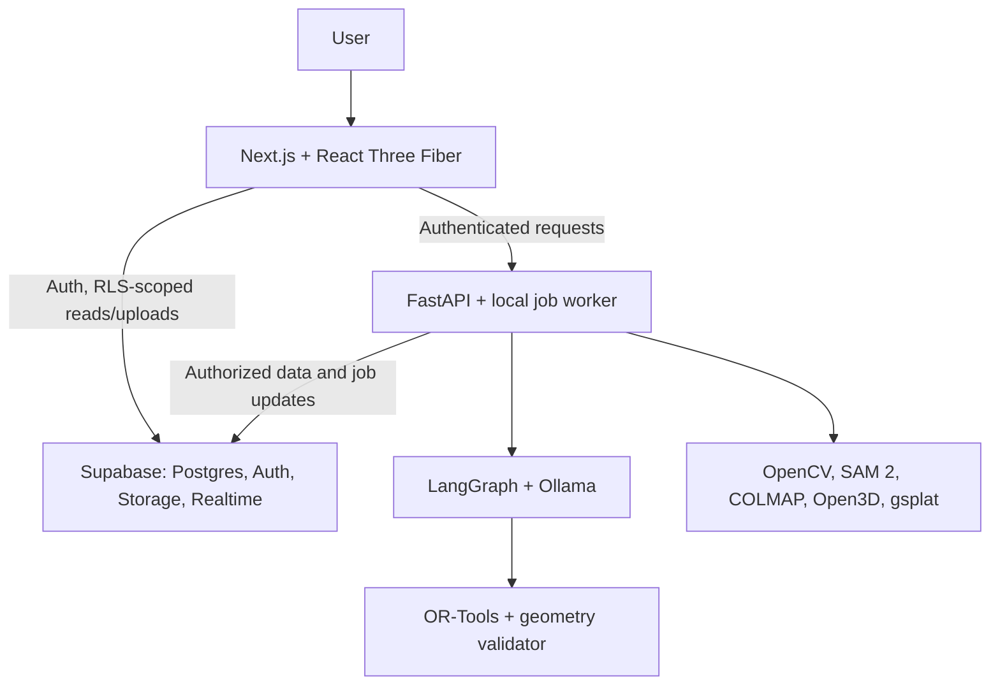

# RentCheck NB — AI Spatial Housing

An AI-native leasing and subleasing platform initially for university students. Its flagship **Spatial Housing Agent** connects apartment discovery, interactive tours, and geometrically grounded furniture planning.

**Status:** README only; all features, schemas, and setup below are proposed. Start with synthetic users/listings and existing 3D assets to minimize data collection.

## 1. Product overview

Beyond marketplace search and standalone tours, users could ask whether furniture fits, inspect supporting geometry, and preview validated arrangements alongside housing comparisons. This distinction remains a product hypothesis.

## 2. Core features

| System | Planned capabilities |
| --- | --- |
| Intelligent marketplace | Apartment/sublease listings; natural-language search; semantic recommendations; location filters; personalized comparisons |
| Apartment digital twins | Image/video uploads; interactive walkthroughs; room/object identification; semantic scene graphs; measurements when geometry supports them |
| Spatial Housing Agent | Interior Q&A; furniture recommendations; constraint-based placement; collision/clearance checks; reviewable 3D edits |
| Roommate/sublease matching | Explicit budget, dates, lifestyle preferences, and compatibility explanations; exclude protected traits from ranking |
| Lease intelligence | PDF extraction; clauses, subleasing restrictions, fees/deposits; retrieval-grounded answers with page citations and abstention |
| Trust and review | Institutional-email confirmation; ownership/authorization evidence workflows; duplicate and consistency flags; human review |

Email confirmation establishes address control; identity and ownership require separate evidence. Verification labels state what was checked. Lease answers flag uncertain/conflicting clauses.

## 3. System architecture



Supabase owns state, access control, media, and progress. Edge Functions validate/enqueue; a FastAPI worker claims persistent PostgreSQL jobs. Realtime reports authorized progress.

FastAPI validates JWTs and resource permissions before accessing data or tools. Worker credentials remain server-only; private assets use authorized, short-lived URLs.

## 4. Technology stack

| Component | Technology | Responsibility | Free/open-source status |
| --- | --- | --- | --- |
| Web | Next.js, TypeScript, Tailwind CSS | Marketplace and review UI | Open source; local hosting |
| Viewer | Three.js, React Three Fiber | Meshes, interactive layouts, splat-renderer integration | Open source |
| Primary backend | Supabase PostgreSQL, Auth, Storage, Realtime, Edge Functions | Data, identity, private assets, events, lightweight handlers | Open-source stack; optional limited hosted Free plan |
| AI service | Python FastAPI | AI, PDF processing, reconstruction, job execution | Open source; local |
| Agents | LangGraph, Ollama | Stateful tool orchestration; local language/VLM inference | Open source; model licenses vary |
| Vision | OpenCV, SAM 2 | Frame quality, segmentation, object tracking | Open source; SAM 2 code/checkpoints Apache-2.0 |
| Geometry | COLMAP, Open3D, gsplat | Camera poses, geometric processing, visual reconstruction | Open source; gsplat Apache-2.0 |
| Optimization | Google OR-Tools | Integer spatial constraint solving | Open source |
| Search/location | pgvector, PostGIS, OpenStreetMap-based maps | Embeddings, proximity queries, map context | Open-source extensions; OSM attribution/service policies apply |
| Documents | PyMuPDF | Lease text/page extraction | AGPL open-source route; license obligations apply |

Supabase consolidates backend services; FastAPI handles heavy Python workloads outside Edge Functions.

[Self-hosting](https://supabase.com/docs/guides/self-hosting) supports larger assets; Supabase's optional [Free plan](https://supabase.com/pricing) limits storage/egress and pauses inactive projects. Hardware still costs resources. Follow [OSM tile policies](https://operations.osmfoundation.org/policies/tiles/), [PyMuPDF AGPL obligations](https://pymupdf.readthedocs.io/en/latest/about.html), and model/asset licenses ([SAM 2](https://github.com/facebookresearch/sam2), [gsplat](https://github.com/nerfstudio-project/gsplat)). No paid APIs or hosting are required.

## 5. AI and 3D pipeline

1. Upload consented photos/video after privacy and coverage review.
2. Store media in private Supabase Storage with ownership records.
3. Queue an idempotent job with visible progress/failure states.
4. Sample frames with OpenCV; use COLMAP to estimate cameras and sparse geometry.
5. Reconstruct geometric surfaces where supported; use gsplat separately for photorealistic views.
6. Use SAM 2 masks/tracks; obtain object labels from local VLM suggestions and human confirmation. Segmentation alone supplies neither identity nor dimensions.
7. Associate masks with geometry across views; build scene relations with provenance/confidence.
8. Align scale using known measurements; validate against different, held-out dimensions.
9. Let the agent retrieve versioned geometry and confirmed object dimensions.
10. Render assets and validated scene edits through Three.js/React Three Fiber.

**Splats represent appearance; they are not collision meshes.** Keep a separate room envelope, object bounds, and door/clearance zones. Monocular reconstruction has scale ambiguity and can fail on mirrors, clutter, and weak overlap. Unscaled or uncertain scenes support visual exploration only; disable fit claims and fall back to photos/manual measured geometry.

## 6. Spatial Housing Agent and optimization

> “Can I fit a queen-sized bed, two desks, and a dresser without blocking the door?”

LangGraph retrieves room geometry and exact furniture dimensions, requesting missing measurements: “queen-sized” does not specify frame size. OR-Tools generates layouts; deterministic validation rejects collisions, boundary violations, blocked door swings, and insufficient clearance. Rank valid candidates, preview edits, explain checked constraints, and save after review.

For positions/orientations $p$, minimize:

$$
\min_p\; \alpha C_{\mathrm{circulation}}(p)
+\beta C_{\mathrm{preference}}(p)
+\gamma C_{\mathrm{movement}}(p)
$$

Penalize circulation inconvenience, unmet preferences, and displacement with nonnegative weights. Hard constraints enforce containment, nonoverlap, and door/path clearance. Start with rectangular footprints, discrete rotations, integer coordinates, uncertainty margins, and independent height checks. [CP-SAT requires integer formulations](https://developers.google.com/optimization/cp/cp_solver).

The LLM cannot override validation. Report solver status, time limits, and geometry assumptions; abstain on uncertain results.

## 7. Database design

| Tables | Main relationships/content |
| --- | --- |
| `profiles`, `properties`, `units`, `listings` | Profile references Auth user; property has owner profile; units belong to properties; listings reference unit and publisher |
| `listing_media`, `rooms`, `spatial_objects`, `scene_assets` | Media/assets belong to listing; rooms to unit; objects to room; assets record scene revision, units, scale, source evidence |
| `reconstruction_jobs` | Listing/media references, requester, status, model/config revisions, artifact references, failure reason |
| `roommate_preferences`, `housing_matches` | Preferences belong to profile; matches reference requester and listing or counterpart profile, scores, explanations |
| `lease_documents`, `lease_chunks` | Restricted owner/unit references; chunks reference document, page, extracted text, embedding |
| `conversations`, `messages` | Conversation belongs to user; messages reference conversation and evidence/tool trace |

Use pgvector for listing/lease-chunk embeddings and PostGIS for property coordinates/proximity. Enforce RLS on every exposed table and Storage object: published listing fields are readable as intended; leases, conversations, and verification evidence remain owner/explicit-reviewer only. Retrieval must filter authorization before returning chunks. Deletion removes documents, derivatives, and embeddings.

## 8. Proposed project structure

```text
apps/web/                 # Next.js UI and 3D viewer
services/ai/              # FastAPI and worker
  agents/                 # LangGraph tools and workflows
  spatial/                # Vision, reconstruction, scene graphs
  optimization/           # OR-Tools and geometry validation
  documents/              # Extraction and cited retrieval
supabase/                 # migrations/, functions/, seed data
packages/shared/          # API contracts and versioned scene schemas
docs/                     # Capture protocol and evaluation
README.md
```

## 9. Development roadmap

| Phase | Concrete deliverable |
| --- | --- |
| 1 | Supabase schema/RLS, authentication, listings UI, seeded fictional marketplace |
| 2 | Natural-language search, local embeddings, constrained recommendations/comparisons |
| 3 | Interactive viewer using existing, licensed 3D assets |
| 4 | Segmentation, confirmed object labels, versioned semantic scene graphs |
| 5 | Measured-room furniture solver, independent collision checks, agent-driven preview |
| 6 | Cited lease answers, preference-based roommate and sublease-date matching |
| 7 | Queued reconstruction from uploads, calibrated geometry, explicit fallbacks |
| 8 | Held-out evaluation, latency improvements, reproducible setup, deployment documentation |

Prioritize phases 1–5 for a semester. Use synthetic users, leases, and scenes plus a small consented photo set. Simulation cannot validate real-world demand or reconstruction accuracy.

## 10. Research and evaluation

Evaluate spatial Q&A accuracy, scene-graph relation accuracy, held-out dimension error, independently checked layout feasibility/collision rate, reconstruction completeness/render quality, recommendation relevance, and p50/p95 latency plus peak memory.

Compare LLM-only placement with solver-validated placement, manual scene graphs with predicted graphs, and keyword search with semantic retrieval. Hold out rooms/scenarios and report failures. Key challenges are cross-view object association, metric accuracy, hallucination control, preference relevance, and efficient local multimodal inference.

## 11. Local development

**Not initialized yet.** Proposed prerequisites: Node.js LTS, Python 3.11+, Supabase CLI, a Docker-compatible runtime, and [Ollama in local mode](https://docs.ollama.com/faq). Proposed infrastructure bootstrap:

```sh
supabase init
supabase start
OLLAMA_NO_CLOUD=1 ollama serve
```

Application setup awaits manifests, pinned dependencies, migrations, environment examples, model downloads, and launch scripts. Keep server secrets private. The CLI stack is development-only. Reconstruction/VLM inference may require substantial RAM/VRAM; precompute demos on supported hardware.

## 12. Future enhancements

AR placement, sunlight simulation from validated orientation/location, labeled virtual staging, digital-twin comparisons, move-in condition inspection, improved roommate recommendations, and richer spatial reasoning models.
