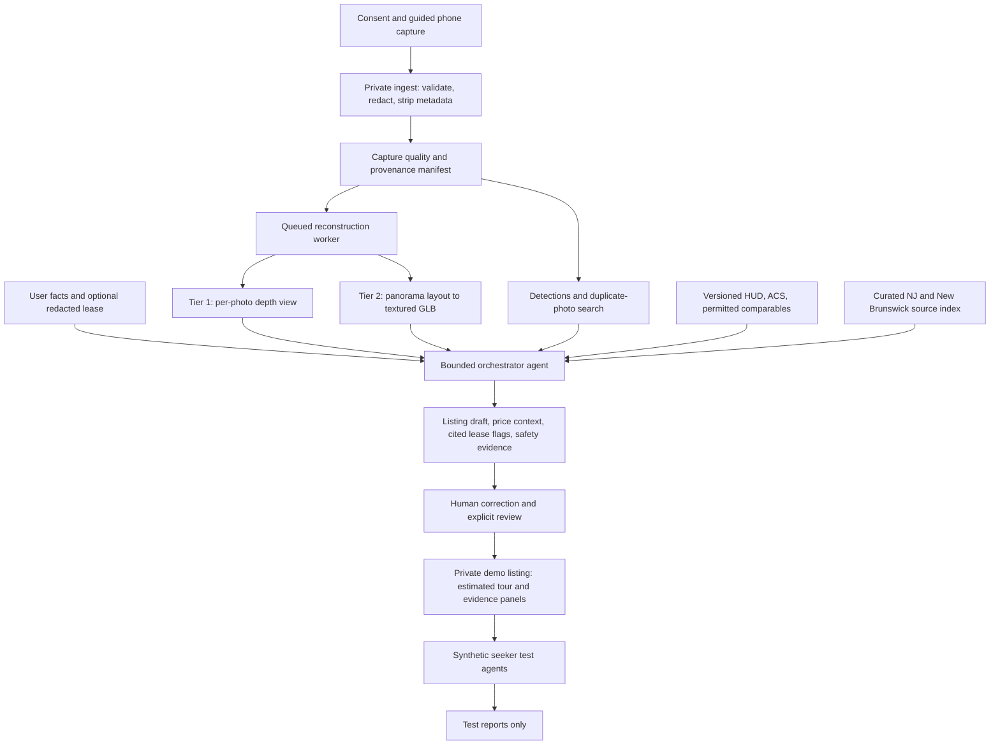

# RentCheck NB

**A semester build plan for RUAI AI4GOOD: five students, twelve weeks, one modest GPU at most.**

> **Pitch:** Turn guided phone captures into an estimated room tour and an evidence-backed student sublet draft, with rent context, lease questions, and photo-reuse warnings in one workflow.

**Repository status:** planning only. No application, scripts, datasets, model integrations, tests, or measured results exist yet. All directories, interfaces, commands, and acceptance criteria below describe work to implement. This README is the sole current deliverable. **VERIFY** marks an unresolved claim, permission, compatibility check, or feasibility dependency; it never means a check has passed.

## 1. Overview and scope

### Community and problem

RentCheck NB serves Rutgers students seeking or offering **one room in New Brunswick, New Jersey**, especially students coordinating a short sublet remotely. Our working hypothesis is that fragmented photos, unclear furniture/amenities, incomparable rents, and uncertainty about subletting permission make listings difficult to assess. We have not validated that hypothesis or demonstrated social impact.

Why now: pretrained vision models make a small inference-first prototype feasible without collecting a large training dataset. Whether this combination solves an urgent local need must come from real students, not the existence of the technology.

Evidence to gather in weeks 1–2:

- **30–50 real survey responses** from current/recent Rutgers room seekers and subletters; recruit through multiple student groups and commuter/international student channels with permission.
- **At least five real interviews**, including seekers and subletters. Ask about the last actual search, missing information, price comparison, permission checks, and trust decisions before showing our concept.
- Record response counts, recruitment channels, dates, question wording, missing answers, and sampling limitations. Publish only deidentified aggregates and consented quotes.
- Use [HUD FMR](https://www.huduser.gov/portal/datasets/fmr.html) and [Census ACS median gross rent](https://api.census.gov/data/2024/acs/acs1/variables/B25064_001E.html) as housing context; neither establishes student demand or individual room value. Do not invent a Rutgers scam rate or affordability statistic.

**Positioning:** 3D tours and floor plans already exist. [Zillow 3D Home](https://www.zillow.com/3d-home/) already supports phone-based virtual tours; Matterport is another established competitor. Phone capture is a design requirement, not unique novelty. Our proposed distinction is the **student sublet workflow combining estimated room exploration, editable listing generation, rent benchmarking, lease-source retrieval, and provenance warnings**. Validate whether students value the bundle more than ordinary photos and a checklist.

### Boundaries

| Commitment | Scope |
| --- | --- |
| Core | Capture coaching; Tier 1 depth views; Tier 2 panorama-to-layout demo; furniture/visible-amenity suggestions; listing draft; public rent context; duplicate/reused-photo checks |
| Agent layer | Bounded tool-calling orchestrator; cited lease Q&A over a curated legal corpus and volunteer lease; synthetic seeker feedback for testing |
| Stretch only | Tier 3 multi-view reconstruction; condition comparison; furniture fit; room Q&A; multi-view consistency as an additional warning |
| Optional research | Tier 4 offline video Gaussian splatting on precomputed demo rooms |
| Explicitly cut | Group matching, rent splitting, live fill prediction, large rent surveys, model training from scratch, automated tenant screening, payments, identity verification, listing syndication, landlord email sending |

This is a consented research/demo prototype, not a production marketplace, legal service, property inspection, or ownership verification system. Finish a small working workflow before adding stretch features. Cap all 3D work, including capture, geometry, export, and viewer integration, at **one third of total team hours**. Log effort weekly; unused stretch time goes to evaluation and UX.

## 2. System pipeline and agent architecture



### Per-stage behavior

| Stage / owner | Inputs → outputs | Method | Failure modes → fallback |
| --- | --- | --- | --- |
| Consent and ingest / D, E | Photos or sphere, optional measurement, consent → private bundle | MIME/decode/size checks; apply orientation; manual redaction review; new opaque IDs | Invalid image, missing consent, unredactable private content → reject or request replacement; no downstream processing |
| Capture coach / B, E | Sanitized images → quality warnings and retake directions | OpenCV blur/exposure checks, overlap hints, human coverage checklist | A sharp image can still miss a wall; thresholds vary by phone → explain uncertainty; allow reasoned override except privacy failures |
| Provenance / B, D | Ingest observations and hashes → evidence manifest | Server receipt time, session nonce, declared source, hash history; private metadata checks before stripping | EXIF can be absent or spoofed → report missing evidence; never infer ownership or authenticity |
| Geometry / A | Bundle → estimated depth asset or room box | Tier policy below; queued pretrained inference | Mirrors, low texture, clutter, non-Manhattan layouts → downgrade with reason; original redacted photos remain available |
| Perception / B | Perspective images → boxes, visible-object suggestions | DETR R50, narrow supported class list | Occlusion, panorama distortion, unsupported amenities → unknown/manual entry; no inferred Wi-Fi, utilities, accessibility, or habitability |
| Duplicate checks / B | Images and private consented reference gallery → matched pairs/evidence | SHA-256, perceptual hash via OpenCV/NumPy, ORB matches with geometric checks | Crops and changed viewpoint escape detection; repeated furniture causes false alarms → show candidate pair for review; no match is not proof |
| Price context / D | Declared rent/basis, utilities, dates, geography → comparable range or insufficient-data result | Public benchmarks plus median/IQR of genuinely comparable room asks, if available | Unit-vs-room mismatch, seasonality, stale data → show separate contextual benchmarks and abstain from room valuation |
| Lease retrieval / C | Redacted lease, question, curated source versions → cited excerpts and flags | pypdf text extraction, TF-IDF retrieval, Qwen grounded drafting | Scans, conflicting sources, stale law, absent clause → manual text review, abstention, source links; never silently treat missing text as permission |
| Orchestration / C, D | Validated module outputs → evidence-bound report | Structured tool requests, schema validation, explicit state machine, persistent job states | Invalid tool call, hallucinated fact, timeouts → one repair attempt, then deterministic template and visible partial status |
| Review/viewer / E | Assets and report → editable private listing | React/three.js, accessible photo/text alternative | WebGL unavailable, slow device → static photos and structured room facts; preserve warnings and evidence |
| Persona harness / C, E | Explicitly synthetic profiles + public demo facts → test feedback | Same local LLM; scripted tasks and expected assertions | Simulated opinions are unreliable → use only to find candidate issues; confirm usability with real outsiders |

### Reconstruction tiers

**Tier 1 and Tier 2 are the committed implementation/demo paths.** “Guaranteed” below means the lowest-risk fallback we commit to build, not a promise that every image yields useful geometry. Tiers 3–4 are optional and cannot become prerequisites for the core workflow. Plan processing in **minutes**, queue one GPU job at a time, and precompute all final-demo rooms.

| Tier | Input and selected method | Output | Known failures and required fallback |
| --- | --- | --- | --- |
| **1 — GUARANTEED, low risk** | Each of 6–10 perspective photos; Depth Anything V2 **Small** relative-depth checkpoint | Independent RGB/depth parallax views or per-photo point clouds in three.js | Relative depth has scale/shift ambiguity; focal-length estimates distort shape. Do not merge unrelated views into a coherent room. Label each view estimated and unscaled; fall back to photos if depth/viewer fails |
| **2 — DEMO PATH, medium risk** | One full 360° × 180° equirectangular sphere; aligned HorizonNet input; pretrained layout inference | Estimated wall/floor/ceiling boundaries; project source texture onto room surfaces; export textured glTF/GLB; bounded orbit and click-to-view original photos | Stitch seams, hidden boundaries, sloped ceilings, mirrors and nonorthogonal walls can break layout. A box does not reconstruct furniture or unseen surfaces. Reject implausible topology; fall back to Tier 1 or a panorama-only viewer clearly labeled without geometry |
| **3 — STRETCH, high risk** | 6–10 overlapping photos from different positions; original VGGT-1B in an isolated research worker | Camera poses and rough confidence-filtered point cloud; optional scale alignment | GPU OOM, weak baseline, reflective surfaces, disconnected poses. Reduce resolution/frame count within the documented preset, then stop; retain Tiers 1–2 |
| **4 — OPTIONAL** | Short, slow walkaround video; nerfstudio/gsplat, offline only | Precomputed Gaussian splat and recorded walkthrough | Pose/optimization cost, floaters, CUDA incompatibility; discard if it consumes core effort. No live or real-time generation claim |

**Scale:** request one actual tape-measured reference segment with marked endpoints and units; prefer a measured wall or door rather than an assumed standard door height. Store its uncertainty and source. Scale Tier 2/3 geometry against that segment; reserve different dimensions for evaluation. A default camera height is an assumption, not ground truth. For relative monocular depth, one measurement does not generally remove all depth ambiguity: any calibrated Tier 1 measurement remains experimental and must report its alignment assumptions. Never claim metric accuracy from three unreferenced photos. All geometry displays **“Estimated geometry”**; unscaled results omit dimension claims. Furniture fit stays disabled until held-out size errors support it.

### Phone sphere capture: verified capability versus local feasibility

Sources checked **2026-10-20**; actual device tests are still **VERIFY**.

| Capture route | Evidence and decision |
| --- | --- |
| **360 Photo Cam, iPhone; candidate app** | [Developer App Store listing](https://apps.apple.com/us/app/360-photo-cam/id6470239030) documents full ground-to-sky sphere stitching and downloads; listing shows version 4.0.0 and in-app purchases/unlocks. **VERIFY** free export count, watermark placement, exact 2:1 projection, device/OS compatibility, and data handling on a real phone. Free installation does not establish a free semester workflow |
| **Polycam 360; evaluated, not default** | [Polycam](https://poly.cam/tools/360-image-viewer) documents iPhone 11+ support and AI infill. Its [export guide](https://learn.poly.cam/hc/en-us/articles/27756102599572-What-File-Types-Can-Polycam-Export) limits free exports primarily to glTF. **VERIFY** usable original sphere export and whether infill can be disabled. Exclude generated regions from geometry scoring and provenance claims; reject an unmarked/unknown infill mask for measured evaluation |
| **Any phone camera + desktop Hugin; zero-subscription fallback** | [Hugin documentation](https://hugin.sourceforge.io/docs/manual/Hugin.html) supports camera-phone inputs and spherical projections. Capture overlapping rows around one fixed optical center, including ceiling and floor; stitch offline, choose equirectangular 360° × 180°, export 2:1, and inspect seams. This may require substantially more than 6–10 source photos; it is a separate sphere workflow, not Tier 3 capture. **VERIFY** successful full-room stitching, installed build, and capture burden in the spike |
| Android app-only route | **VERIFY:** no universally supported, free full-sphere capture/export app established here. Support ordinary-photo Tier 1 on Android and test the phone-plus-Hugin route; do not advertise universal app-only sphere capture |

Capture instructions: remove private items and people, keep lighting steady, rotate around a fixed position for spheres, follow the app's full vertical coverage prompts, and export the actual image to Files/desktop. A normal horizontal panorama or a screenshot of a sphere viewer is insufficient. Check 2:1 dimensions **and** visually verify ceiling, floor, seam closure and absence of fabricated content. For multi-view capture, move between positions with roughly 60–80% overlap and include corners; rotating in place alone supplies little translation. Keep redaction masks consistent across overlapping views.

### Bounded agent/tool calling

Pick a small explicit Python orchestrator rather than a multi-agent framework for production. The LLM may request allowlisted tools: `inspect_capture`, `reconstruct_room`, `detect_objects`, `find_duplicates`, `benchmark_rent`, `retrieve_lease_evidence`, and `draft_listing`. The backend validates inputs, tenant/session ownership, prerequisites, and output contracts before executing anything. Geometry, rent arithmetic, and duplicate decisions remain deterministic tools; the LLM cannot override them.

Persist states `queued`, `running`, `succeeded`, `partial`, `failed`, `cancelled`. Use idempotency keys per bundle/module/model revision; maximum eight tool calls and one repair per report; sequential GPU work; stage timeout initially 10 minutes, then tune from spike logs. Missing consent halts all work. Other failures produce typed partial results. Record tool arguments, evidence IDs, elapsed time and model revisions without raw PII. Compare this agent with a fixed pipeline using identical tools to justify its complexity.

Treat leases, listing text and retrieved passages as untrusted data. No arbitrary URLs, shell tools, email tools, browser automation, external publishing, or tool execution triggered by document instructions. The landlord-consent email is an editable draft for the student to copy after review. Synthetic persona agents run separately with no access to private leases or ingest storage.

## 3. Prioritized functional requirements

Targets are proposed acceptance gates, not achieved results. P0 blocks a complete core demo; P1 follows stable P0; P2 never delays it.

| ID | Priority | Requirement and acceptance criterion |
| --- | --- | --- |
| F01 | P0 | Consent and privacy: reject missing consent; apply orientation before stripping EXIF; require redaction review before assets leave private ingest; seeded private-content tests leak zero sensitive fields to public outputs |
| F02 | P0 | Capture coach: accept 6–10 photos or a valid sphere; flag blur/lighting/coverage with actionable retake steps; test at least 20 deliberately degraded cases and report misses and false alarms |
| F03 | P0 | Tier 1: all accepted spike photos yield either a view or a typed failure; user can switch photos; estimated/unscaled labels remain visible |
| F04 | P0 | Tier 2: two consented, precomputed rooms load textured GLB in the browser with orbit/photo links; topology/scale validation and downgrade reasons are visible; a manually edited box is labeled as such |
| F05 | P0 | Detection/listing: supported visible classes have image evidence; users can correct suggestions; no unsupported amenity enters a draft without explicit user confirmation; deterministic listing template works if LLM fails |
| F06 | P0 | Rent context: display currency, monthly room/unit basis, utilities, geography, source date and sample size; incompatible comparables produce insufficient-data status, not a fair-price verdict |
| F07 | P0 | Duplicate/provenance: show matching evidence, source-gallery scope and limitations; imports and absent metadata are labeled; never display a verified-property/verified-3D badge |
| F08 | P0 | End-to-end UI: submit, see progress, recover from failed geometry, review evidence, edit draft, export text, delete a session; three seeded demo scenarios complete without developer intervention |
| F09 | P1 | Agent: valid tool sequence with bounded retries, evidence trace and deterministic fallback; all adversarial tool-escape fixtures rejected |
| F10 | P1 | Lease Q&A/email: cite lease page and legal source section/version, separate lease clause from legal context, abstain when unsupported; draft email includes no invented permission or facts and is never sent |
| F11 | P1 | Persona harness: at least 12 labeled synthetic profiles run scripted listing tasks; failures link to assertions; reports never count as interviews, survey evidence, or human usability scores |
| F12 | P1 | Accessibility/usability: keyboard controls, text/photo alternative, focus/status announcements, no color-only warnings and reduced-motion mode; run the 15+ student study in section 6 |
| F13 | P2 | Tier 3 and multi-view signal: log registration failures separately from suspicious-content findings; failure alone cannot accuse a listing of fraud |
| F14 | P2 | Condition diff, furniture fit, room Q&A: only after feature gates; distinguish lighting/view changes from damage; no fit guarantee or hidden-room fact |

## 4. Tech stack, versions, and licenses

### Choices

| Layer | Pick and reason | One alternative / switching condition |
| --- | --- | --- |
| Frontend | React + TypeScript + Vite; familiar component model and static build | Svelte if team already knows it; no midsemester rewrite |
| 3D viewer | three.js directly; one renderer for points, panorama and GLB | Babylon.js if built-in scene tooling materially reduces effort |
| API / contracts | FastAPI + Pydantic + Uvicorn; typed validation and generated OpenAPI | Flask for a simpler synchronous-only prototype |
| Jobs/storage | Single local worker, SQLite job metadata, private filesystem artifacts; easy to rebuild | PostgreSQL if actual concurrent writes exceed SQLite's needs; **VERIFY** selected server version/hosting terms before switching |
| Geometry | Depth Anything V2 Small + HorizonNet; simple fallback plus panorama layout | LGT-Net for layout only if HorizonNet fails its spike; no model bake-off after week 2 |
| Perception/duplicates | DETR R50; OpenCV/NumPy hashes + ORB; no new training | User-confirmed manual tags + exact hashes as the low-compute baseline |
| LLM/agent | Local Qwen2.5-1.5B-Instruct via Transformers, bounded custom tool dispatcher | LangGraph only if handoff/recovery complexity justifies it; deterministic templates remain the no-LLM fallback |
| Lease retrieval | pypdf extraction + scikit-learn TF-IDF, top 5 chunks; auditable small corpus | SQLite FTS5 lexical retrieval; no embedding model required |
| Deployment | Laptop demo, frontend static build and API loopback; GPU preprocessing on available student compute | Approved university host for private pilot; **VERIFY** quota, authentication, HTTPS and retention before use |
| Tracking | Versioned JSON/CSV run manifests and error-analysis tables | MLflow local tracking if plain files become hard to compare |
| Checks | pytest for meaningful contracts/integration/privacy checks; Ruff for Python lint; TypeScript compiler for UI | Peer-run documented acceptance checklist during initial spike only |

No paid inference service is required. No free-cloud always-on GPU or persistent Colab endpoint is assumed. Run models sequentially and unload between stages. Use reduced image sizes established in the spike; record preprocessing exactly. Prefer CPU for hashes/retrieval. Leases stay local unless a volunteer separately consents to an approved compute environment.

### Model ledger

Upstream repositories/model cards checked on **2026-10-20**. A repository license does not automatically establish checkpoint, training-data, output, or third-party component rights. Store exact license copies and weight SHA-256 values before use. Recheck before redistribution or commercial deployment. No benchmark values from model papers are presented as RentCheck results.

| Component / exact candidate | Version or revision | License and restrictions / decision |
| --- | --- | --- |
| [Depth Anything V2 Small](https://github.com/DepthAnything/Depth-Anything-V2); `Depth-Anything/Depth-Anything-V2-Small` | Model revision `03876f8651c73a60fe4c2c48294e09fcb6838fcf`; source commit **VERIFY** | Small checkpoint Apache-2.0; retain notices. Base/Large/Giant are CC-BY-NC-4.0; do not substitute silently |
| [HorizonNet](https://github.com/sunset1995/HorizonNet); `resnet50_rnn__mp3d.pth` | Source `43b7fdea131e306f781a57b5476dd37390040fa5`; checkpoint hash **VERIFY** | Code MIT. **VERIFY** explicit checkpoint redistribution/use terms and Matterport3D training-data restrictions; code MIT alone is insufficient. Block that checkpoint until terms are documented |
| [LGT-Net](https://github.com/zhigangjiang/LGT-Net), layout alternative | Source `f25c0c27c90ab5d2a6d3ac64b5eaaeff31d26ab2`; checkpoint selection **VERIFY** | Code MIT; **VERIFY** selected checkpoint/dataset terms. Not an automatic license workaround |
| [DETR R50 checkpoint](https://huggingface.co/facebook/detr-resnet-50) | `1d5f47bd3bdd2c4bbfa585418ffe6da5028b4c0b` | Model card Apache-2.0; retain notices and inspect backbone/dependency notices; limited COCO classes |
| [Qwen2.5-1.5B-Instruct](https://huggingface.co/Qwen/Qwen2.5-1.5B-Instruct) | `989aa7980e4cf806f80c7fef2b1adb7bc71aa306` | Model card Apache-2.0. Check selected files; other Qwen sizes can have different licenses. Local adequacy for grounded answers **VERIFY** |
| [VGGT](https://github.com/facebookresearch/vggt); original `facebook/VGGT-1B` | Original checkpoint revision `860abec7937da0a4c03c41d3c269c366e82abdf9`; source commit **VERIFY** | Original weights CC-BY-NC-4.0, research-only choice here. Current code uses custom VGGT terms; separate commercial checkpoint has different terms and access requirements, including use restrictions. Do not confuse checkpoints |
| [DUSt3R](https://github.com/naver/dust3r) / [MASt3R](https://github.com/naver/mast3r), considered but not selected | Exact revisions/checkpoints **VERIFY** before any use | Code CC-BY-NC-SA-4.0; checkpoint/data notices add restrictions, especially MASt3R. Not dependencies or commercial fallback recommendations |
| [nerfstudio](https://github.com/nerfstudio-project/nerfstudio) / [gsplat](https://github.com/nerfstudio-project/gsplat), Tier 4 only | Published versions 1.1.5 / 1.5.3; compatible pair **VERIFY** | Apache-2.0 upstream; inspect selected method, CUDA and bundled dependencies separately. Do not import original research splatting code under an assumed matching license |

A checkpoint with unresolved permission is a **hard gate**, even for an attractive demo. Use a cleared alternative or show the downgraded path. Tier 2 remains a planned commitment until its permission and feasibility gates pass; if they fail, record the scope change explicitly with the mentor.

### Library ledger

Versions below are **published registry snapshots**, not a tested lockfile or a claim that these are mutually compatible. Sources are the linked publisher-managed package records and upstream license files. In week 1, select compatible versions for each isolated environment, save exact locks and licenses, and update this table. Do not install every newest release together, particularly for old layout research code.

| Library | Published version checked | Declared license / qualification |
| --- | --- | --- |
| [React](https://registry.npmjs.org/react/latest) | 19.3.1 | MIT |
| [Vite](https://registry.npmjs.org/vite/latest) | 8.3.4 | MIT |
| [TypeScript](https://registry.npmjs.org/typescript/latest) | 7.0.2 | Apache-2.0 |
| [three.js](https://registry.npmjs.org/three/latest) | 0.186.1 | MIT |
| [FastAPI](https://pypi.org/project/fastapi/) | 0.150.0 | MIT |
| [Pydantic](https://pypi.org/project/pydantic/) | 2.14.1 | MIT |
| [Uvicorn](https://pypi.org/project/uvicorn/) | 0.54.0 | BSD-3-Clause |
| [PyTorch](https://pypi.org/project/torch/) | 2.14.1 | Wheel metadata lists multiple licenses, including BSD/Apache/MIT; preserve bundled notices; GPU compatibility **VERIFY** |
| [torchvision](https://pypi.org/project/torchvision/) | 0.29.1 | BSD metadata; exact distribution notices and matching torch version **VERIFY** |
| [Transformers](https://pypi.org/project/transformers/) | 5.20.2 | Apache-2.0; separate model licenses still apply |
| [safetensors](https://github.com/huggingface/safetensors) | 0.8.0 | Upstream Apache-2.0; distribution license confirmation **VERIFY** |
| [NumPy](https://pypi.org/project/numpy/) | 2.5.4 | BSD-3-Clause plus bundled notices; metadata also lists 0BSD/MIT/Zlib/CC0 |
| [Pillow](https://pypi.org/project/pillow/) | 13.0.0 | MIT-CMU; inspect bundled codecs |
| [OpenCV Python](https://pypi.org/project/opencv-python/) | 5.0.0.93 | Apache-2.0 metadata; inspect binary dependencies |
| [pypdf](https://pypi.org/project/pypdf/) | 6.21.1 | BSD-3-Clause |
| [scikit-learn](https://pypi.org/project/scikit-learn/) | 1.9.1 | BSD-3-Clause |
| [pytest](https://pypi.org/project/pytest/) / [Ruff](https://pypi.org/project/ruff/) | 9.1.1 / 0.17.1 | MIT / MIT |
| [Svelte](https://registry.npmjs.org/svelte/latest), frontend alternative | 5.57.2 | MIT |
| [Babylon.js](https://registry.npmjs.org/@babylonjs/core/latest), viewer alternative | 9.31.0 | Apache-2.0 |
| [Flask](https://pypi.org/project/flask/), API alternative | 3.1.3 | BSD-3-Clause |
| [LangGraph](https://pypi.org/project/langgraph/), agent alternative | 1.2.16 | MIT; separately inspect any added integration |
| [MLflow](https://pypi.org/project/mlflow/), tracking alternative | 3.17.1 | Apache-2.0 |

Runtime/tools: proposed Python 3.12 (PSF license) and an actively supported Node.js LTS (MIT plus bundled notices); exact supported patch versions and package compatibility **VERIFY** in week 1. SQLite is public domain; use the Python runtime's version and record it. npm is supplied with Node; retain its distribution notices. [Hugin 2025.0.1 release](https://hugin.sourceforge.io/releases/2025.0.1/en.shtml) is a candidate standalone stitcher; **VERIFY** installed binary version and GPL terms, including bundled stitching components, before redistribution. Proprietary capture apps are governed by their own terms, not our repository license. Project code license is **not yet selected**; choose it with all five contributors and exclude third-party weights/private data.

## 5. Data plan

No large dataset and no initial model training. Tune only quality thresholds, retrieval settings and deterministic rules on development data. Keep evaluation split by **room, lease, source image and participant**, not by individual photo. Never let crops or different captures of the same room cross train/dev/test boundaries.

| Data / quantity | Source; real or synthetic | Use and split | Handling / limitations |
| --- | --- | --- | --- |
| 10–15 rooms | Consenting Rutgers/New Brunswick volunteers; real | 2–5 development rooms including spike; **8–10 locked evaluation rooms**, each with sphere and photo set where feasible; separately consented demo subset | Measure ground truth; include clutter, mirrors, low light and odd/sloped layouts. If enrollment is only 10, use 2 dev + 8 test; do not advertise 10 test rooms |
| 3–5 leases | Volunteers; real, redacted | 1–2 development; 2–3 held-out depending on total; document limited diversity | Remove names, signatures, addresses, contacts, account numbers; local extraction/manual review; no public raw leases |
| HUD FMR snapshot | [HUD datasets](https://www.huduser.gov/portal/datasets/fmr.html); real public aggregates | Context/demo, not room-price labels | Record fiscal year, effective date, geography and bedroom basis; **VERIFY** latest applicable vintage at ingestion |
| ACS snapshot | [Census ACS](https://data.census.gov/); real estimates and margins of error | Local housing context, not individual labels | Prefer suitable 5-year geography; record vintage/table/estimate/MOE. B25064 is median gross rent; never combine it with FMR as if both were room rents |
| Small RentCast pull | [API](https://developers.rentcast.io/reference/getting-started-guide); real records | Up to 20 initial requests within a hard local quota; source inspection and optional comparable analysis | **VERIFY** cache, redistribution, attribution and evaluation permissions first. Free plan documents 50 monthly calls with overage charges; enforce a zero-overage cap. No paid dependency |
| Optional comparable room asks, 20–40 if obtainable | Consented listings or permissioned sources; real | Development/held-out split by property; record asking vs executed rent | Do not scrape restricted platforms. If comparable room records are too few, show contextual benchmarks only; do not fill the gap with synthetic prices |
| Duplicate corpus | Consented photos + seeded crops, resizes, JPEG recompression and unrelated photos | At least 100 positive and 100 negative test pairs, grouped by source/room; threshold tuning uses separate sources | Label transformed copies as generated test variants; these are controlled duplicates, not real scam incidents. Include same-furniture hard negatives |
| Detection labels | About 100–150 perspective images across consented rooms | Boxes/presence labels for supported classes, split by room | Two students review at least 20%; record disagreements; no face identity or tenant attributes |
| Survey/interviews | 30–50 responses and 5+ interviews; real people | Problem validation only; may inform requirements | No exact address required; optional broad housing context; separate contact list from responses; avoid fabricated quotes |
| Usability participants | 15+ real students outside team | Final task study; aim for a separate 3–5-person formative pilot | Separate participants where possible; disclose overlap with validation and do not count repeat sessions as new people |
| Legal corpus | [NJ DCA Truth in Renting](https://www.nj.gov/dca/home/landlord-tenant.shtml), [NJ Legislature](https://www.njleg.state.nj.us/), [New Brunswick Municipal Code](https://library.municode.com/nj/new_brunswick) | Retrieval only, versioned by source/document/section | **VERIFY** exact current statute sections, code provisions, amendments and redistribution terms. City code site warns online/PDF copies may omit updates; link sources and abstain on unresolved conflicts |
| 12–20 synthetic personas; 40–60 synthetic/adversarial scenarios | Local LLM and human-written test authors | Schema tests, UI stress, prompt-injection tests, simulated seeker feedback | Prefix IDs `syn_`; retain prompt/model/seed; vary budget, device, mobility needs, language comfort and deadlines without stereotypes. Never use for price labels, problem validation, human usability claims, or scam prevalence |

### Privacy lifecycle

Obtain separate permission for capture, research evaluation and public demo assets; property occupants' consent matters as well as the uploader's. Do not capture roommates' private spaces without permission. At ingest, inspect EXIF privately for limited consistency signals, apply orientation, keep only a minimal derived manifest (e.g., timestamp present/absent and consistency warning), then strip EXIF/GPS/device identifiers from every derivative. Server receipt time is distinct from claimed capture time.

Before sharing or cloud inference, manually review and blur faces, documents, screens, mail, reflections and identifying details; allow masks to be corrected. Redact textures **before** GLB generation so a hidden texture cannot leak the original. Keep raw files encrypted locally with access limited to the collecting pair; processed private files require session authorization. Public demo assets get a separate opt-in and no exact address.

Proposed retention: delete raw images/leases within seven days of reviewed processing; delete nonpublic processed assets within 30 days after final presentation, or earlier on withdrawal. Track expiry in the manifest and test deletion across files, database rows, derived textures, private hashes and backups. Public aggregates must not enable reidentification. Keep consent records separately under an agreed retention policy (**VERIFY** institutional requirements). Private data, credentials and raw leases never enter Git or LLM logs. A small demo does not justify collecting IDs or background-check data.

### Price method

Call the output **rent context / comparable asking range**, not a certified fair rent. Normalize monthly currency, room vs entire unit, lease dates, utilities and furnished status. Show HUD whole-unit 40th-percentile gross rent and ACS median gross rent in separate contextual cards with their geography/vintage. Do not divide whole-unit rent by bedrooms and label the result a room valuation. If displayed at all, equal-share arithmetic must be explicitly user-selected and labeled an illustrative scenario.

For at least ten sufficiently matched real room asks in a declared comparison group, use median and IQR with sample count and date range. With fewer or incompatible records, abstain from an estimated range. Do not call an IQR a calibrated prediction interval. Exclude protected traits, inferred wealth and neighborhood demographic proxies; do not adjust prices using invented visual quality scores. Any future supervised model requires independently sourced real labels and a new evaluation plan.

## 6. Evaluation plan

**No results yet. Every numerical target below is a hypothesis to test.** Lock splits, metrics, thresholds and failure rules before final evaluation. Record counts alongside percentages; report uncertainty and individual failures because 8–10 rooms cannot establish general performance. Failed cases remain in denominators. All module reports include latency, peak memory, hardware and model/config revisions.

| Module | Baseline → proposed method | Test set and metrics | Initial target / decision gate |
| --- | --- | --- | --- |
| Capture quality | Human checklist → blur/exposure rules + coverage hints | 20+ degraded/control examples on multiple phones; warning precision/recall, unnecessary retakes | Aim recall ≥0.85 for labeled severe defects; inspect false warnings before blocking captures |
| Geometry | Relative depth-only → panorama layout | 8–10 held-out rooms; dimension errors, coverage, failure rate, topology review, minutes/room | Hypothesis: Tier 2 median absolute relative dimension error ≤15%, with ≥80% valid outputs. Report actual tail errors; hide size/fit claims if unsupported |
| Detection | Manual tags / class-prior baseline → DETR | Held-out room images; per-class AP50 and presence precision/recall; visible class coverage | Aim precision ≥0.85 for suggestions shown by default; uncertain/rare classes require confirmation; no overall score hiding failed classes |
| Listing | Fixed facts-to-template → grounded LLM draft | 30+ cases including missing/conflicting facts; factual support, unsupported-claim count, edit time, two-reviewer usefulness rating | Zero critical invented rent, permission, availability or safety claims; otherwise fall back to template; report all unsupported claims |
| Rent | Public context / unfiltered real-room median → normalized comparable median/IQR | Held-out real asks if available; MAE in dollars, relative error, sample coverage, abstention rate, utility/basis errors | No predictive accuracy claim without adequate matched labels; must beat unfiltered baseline to claim improvement. Context-only mode is acceptable |
| Duplicates | SHA-256 equality → perceptual hash + ORB | 100+ positive, 100+ negative held-out pairs; precision/recall by transformation; false alerts on unrelated similar rooms | Aim precision ≥0.95, recall ≥0.85 on seeded variants; publish confusion matrix and gallery coverage; not a real-world fraud recall claim |
| Lease Q&A | Exact keyword passages → TF-IDF + grounded LLM | 30+ held-out questions across 2–3 leases and curated sources; retrieval recall@5, citation correctness/support, abstention, harmful-answer count | Aim retrieval recall ≥0.90 and supported/correct citations ≥0.95; zero fabricated legal authority or definitive permission on unresolved cases |
| Safety assessment | Checklist only → duplicate/provenance evidence panel | 40–60 controlled scenarios: honest import, altered timestamp, reused photo, unrelated room, injected instructions, unknown evidence | Per-warning precision/recall and unknown handling; zero tested ownership-verification claims; no calibrated fraud probability |
| Agent | Fixed pipeline with same tools → bounded tool caller | 30 scripted normal/partial/adversarial jobs; task completion, schema validity, tool misuse, cost/latency | 100% tested unauthorized calls rejected; aim ≥90% ordinary task completion; retain fixed pipeline if agent adds no measurable benefit |
| UX | Photo/text draft → integrated workflow | 15+ outsider students; task success, time, errors, intervention count, SUS, warnings understood | Aim ≥80% complete core tasks unaided; aim SUS ≥70; report sample and accessibility failures, not population-wide conclusions |

### Tape-measure geometry protocol

1. Recruit 10–15 rooms; reserve 8–10 for final testing. Include ordinary and difficult rooms deliberately; record layout type, clutter, mirror, lighting and device tags without person demographics. Declare sampling limits.
2. Two people measure length, width and height (or fixed named segments for irregular rooms) twice with a tape. Resolve disagreements exceeding 2 cm by remeasurement; store units and uncertainty. Create a sketch and mark endpoints. Do not force an irregular room into a rectangle for scoring.
3. For **every evaluation room**, collect both a sphere and a guided photo set where permission allows. Missing inputs are reported as coverage failures for the applicable method. The one-sphere/one-set week-1 spike alone is not this comparison dataset.
4. Reserve one measured segment solely for scale calibration. Keep remaining dimensions hidden from the person processing predictions. Use identical permitted calibration information for both methods; never fit against the held-out dimensions.
5. Depth-only baseline: back-project perspective depth using documented intrinsics/assumptions, pick visible endpoints using a fixed annotation protocol, apply the development-set-fixed calibration, and attempt only supported dimensions. Relative depth may make metric comparison invalid; mark those cases unmeasurable and report coverage instead of presenting fitted measurements as accurate.
6. Layout method: infer boundaries, scale with the calibration segment, export GLB and measure the same held-out dimensions. Record automated and manually corrected runs separately; compare methods on their common measurable subset **and** report all-room success/coverage.
7. Report absolute error in cm, absolute relative error per dimension, room-level median, overall median and 90th percentile, signed bias, worst cases, catastrophic topology failures and runtime. Resample at room level if giving bootstrap intervals; disclose that the sample is small. Never count multiple dimensions as independent rooms.
8. Publish a failure-case report with permissioned examples: low light, occlusion, mirrors, clutter, stitching errors, nonorthogonal walls, sloped ceilings and calibration mistakes. If metric estimates fail, keep visually explorable estimated geometry and remove dimension claims.

### Labels, errors and user study

Use two reviewers for listing/lease/safety outputs; resolve disagreements and record both original judgments. Lease answers are a small research assessment, not legal validation; **VERIFY** mentor or qualified review of reference answers. Include answerable, absent-clause, contradictory-source, stale-source and prompt-injection questions. No scanner/OCR success is assumed: scanned leases return a manual-text-needed state.

Each error record contains: case ID; real/synthetic label; split; module/config/model revision; expected outcome; actual outcome; evidence IDs; severity; room/device/source tags; likely cause; fix/fallback; owner; retest result. Give numerator/denominator, not just a score. Do not retune on final test cases; new fixes require a new untouched test or a clearly labeled post-test analysis.

Usability protocol: run a formative pilot with 3–5 outsiders in weeks 3–5, then a final study with **15+** students in weeks 8–10. Without coaching, ask participants to submit a capture, recover from a retake warning, inspect a tour, correct an amenity, interpret room-vs-unit rent, inspect duplicate evidence, find a lease citation, and delete their session. Use supplied deidentified fixtures rather than requiring personal lease uploads. Observe before intervening; count intervention as unaided failure. Counterbalance basic-photo and integrated workflows where feasible; measure time, completion and comprehension, then SUS and short interviews. Test keyboard navigation, readable contrast, zoom, reduced motion and photo-only access. Report recruitment bias and small subgroup counts; rerun failed tasks after fixes.

## 7. Ethics and safety: mechanisms to build

| Risk | Concrete mitigation / owner | Verification evidence |
| --- | --- | --- |
| Bias/domain shift | Test actual New Brunswick student rooms; per-condition failure tags; uncertain detections require confirmation; no protected-trait inference / A, B | Error slices for clutter, light, mirrors and unusual layouts; no broad fairness claim from tiny samples |
| Private homes/leases | Consent gate, local redaction review, metadata stripping, private assets, expiry/deletion path / D, E | Seed faces/reflections/PII/GPS; inspect photo, GLB textures, exported text, logs and deletion outcomes |
| Environmental cost | Small pretrained models, no initial training, cached outputs, one GPU job, fixed resolution/call/time budgets / A, D | Log GPU/CPU minutes, wall time, peak memory and LLM tokens; compare lighter baseline. Estimate energy from measured power or a labeled power assumption; do not invent carbon savings |
| Fake listings and trust laundering | No “verified 3D tour” badge; show capture provenance limitations, photo matches and source scope; immutable server-side evidence IDs / B, E | Replay/import/spoofed-metadata tests; missing proof remains unknown; UI cannot promote a reconstructed room to ownership proof |
| False scam accusation | Evidence-level warnings and appeal/correction UI; no public blacklist, no opaque fraud score / B, E | Hard negatives and genuine reused photos; check user interpretation and false alerts; poor registration alone never means fraud |
| Legal hallucination | Versioned sources, excerpt-level citations, answer validator and abstention; email draft only / C | Known-answer and unsupported-question tests; zero fabricated sections; no “sublet approved” output |
| Price misuse | Clear rent basis, sample size, geography/date; no synthetic labels or discriminatory features; insufficient-data state / D | Unit/room and utilities mismatch fixtures; no ranking or tenant eligibility decisions |
| Prompt injection | Treat source text as data, tool allowlist, schema/ownership checks, no arbitrary network/actions / C, D | Malicious lease/listing/tool-output tests; log attempted calls and prove blocked actions |
| Accessibility/exclusion | Ordinary-photo capture, photo/text fallback, keyboard path, no required LiDAR; no special phone purchase / E | Outsider tasks on available Android/iPhone and low-end laptop; document unsupported sphere routes |
| Misleading synthetic feedback | Visible synthetic tags and isolated persona harness; no simulated testimonials / C, E | Audit every chart/table for real/synthetic provenance and participant counts |

**Provenance is limited evidence.** Capture-time checks compare timestamps where present, receipt time and session continuity; optional guided recapture can add consistency evidence. EXIF and device claims are user-controlled. Duplicate search covers only the permissioned local gallery; we do not claim internet-wide reverse image search. Multi-view registration can fail on an honest room and succeed on a staged or copied one. Reconstruction establishes neither access rights nor a safe transaction.

## 8. Proposed repository layout and ownership

Everything below is **planned**, not present. Role letters map to section 11. This README remains the specification until implementation begins.

```text
app/                         E: capture, review, accessibility, three.js viewer
src/
  api/                       D: authorization, upload limits, jobs, deletion
  capture/                   B + E: quality checks and capture instructions
  reconstruction/            A: isolated tier adapters, scale, export
  perception/                B: supported objects and duplicate evidence
  agents/                    C: bounded orchestrator and persona harness
  lease/                     C: text chunks, retrieval, citations, abstention
  pricing/                   D: normalization and contextual benchmarks
  contracts/                 D + all: schemas, evidence types, shared errors
  pipeline/                  D + C: deterministic DAG and worker integration
configs/                     D: reproducible presets and source manifests
notebooks/                   A + B: feasibility experiments; sanitized outputs only
scripts/                     D: future CLI adapters, evaluation and demo seeding
schemas/                     D: exported versioned JSON Schemas
data/                        D: private local root; excluded from Git by default
  raw/                       consented originals; short retention, encrypted
  processed/                 redacted inputs, private derived assets
  splits/                    room/lease/source-separated manifests, no PII
  demo/                      separately permissioned sanitized fixtures
  synthetic/                 clearly tagged personas/test cases
models/                      A + C: local weights; excluded from Git
runs/                        D: run IDs, metrics, hashes; reviewed before sharing
tests/                       all: meaningful contracts, privacy, module/integration checks
docs/                        all: future evidence, setup, data cards, model cards,
                             error analysis, threat model, usability, demo/Q&A
README.md                    all: current project specification and status
```

Use `snake_case` Python/files and JSON keys; UI components `PascalCase`; opaque IDs `room_###`, `lease_###`, `case_###`, and `syn_###`; no names or addresses in filenames. Run ID: UTC timestamp plus short Git commit, with seed in its manifest. Store units in field names or explicit unit fields. Branches follow `feat/<module>-<topic>`; every integration change gets an owner and a second reviewer. Pin source URLs, document versions, model revisions and hashes separately from human-readable names. Private split manifests stay private; publish deidentified summaries only. Future `docs/` references are planned outputs, not working links.

## 9. Interface contracts

These are **language-neutral schema requirements**, not application code. In week 2, D converts them into JSON Schema/Pydantic contracts and fixture examples; all five owners review before independent implementation. Mock results must carry `mode=mock` and cannot enter measured results.

### Shared conventions

Every result requires `schema_version` (start `1.0`), `job_id`, `bundle_id`, `status` (`ok`, `partial`, `failed`, `insufficient_data`), `mode` (`live`, `precomputed`, `mock`), `created_at` (UTC ISO 8601), `method`, `model_revision` (nullable only for non-model stages), `config_hash`, `duration_ms` (nonnegative integer), `evidence_ids` (array), `warnings` (array of code/message), and `error` (nullable code/retryable/message). JSON numbers must be finite; absent evidence is null/unknown, never zero confidence or a negative finding. Unknown fields are rejected in v1; incompatible changes increment the major version.

Evidence records require immutable ID, source type, bundle/session scope, private asset ID or allowlisted source URL, page/section or image region when applicable, source date, and retrieval date. Access checks precede URL resolution; no raw disk paths or permanent public URLs in module payloads. Geometry uses right-handed coordinates, Y-up, with explicit meters or arbitrary units and a stored source-to-viewer transform. Convert camera conventions at the adapter boundary. Boxes are normalized image `xyxy` in [0,1] with ordered corners.

| Contract | Required payload and constraints | Consumer / failure example |
| --- | --- | --- |
| **PhotoBundle** | Bundle/room/session IDs; capture mode `photos` or `equirectangular`; 6–10 photo records or one sphere; each record has opaque asset ID, SHA-256, width/height, orientation-normalized flag, redaction-review flag, capture source `in_app/import/stitched`, infill status `none/marked/unknown`; consent scope/expiry; private provenance-manifest ID; optional calibration with value >0, unit, endpoints and uncertainty | All modules; missing consent → rejected; sphere shape alone does not establish valid projection |
| **ReconstructionResult** | Tier 1–4; representation `per_photo_depth/point_cloud/room_box/panorama/splat/photos`; asset IDs; source photo IDs; estimated=true; units; coordinate transform; scale status `unscaled/reference_scaled/assumed`; calibration evidence; optional dimensions with uncertainty; validity checks and downgrade reason | Viewer and report; no dimensions allowed for unscaled/invalid geometry; Tier 1 views never imply registered cameras |
| **Detections** | Array of class/label, photo ID, box, score in [0,1], evidence ID, confirmation `unreviewed/accepted/rejected`; supported-class-list revision; amenities array with `detected/user_confirmed/unknown` source | Listing; model confidence is not a calibrated probability or confirmation |
| **ListingDraft** | Title/body; structured facts with value, unit/basis when relevant, evidence IDs and provenance `user/model/source`; missing-info questions; corrections; review state `draft/reviewed`; no publish/send action | UI; unsupported claim → removed/question, not completed by the LLM |
| **PriceEstimate** | Currency `USD`; period `month`; basis `room/whole_unit`; utilities `included/excluded/mixed/unknown`; geography/date range; comparable count; source refs; method; contextual benchmarks array; nullable range with low ≤ high and interpretation; abstention reasons | UI; HUD/ACS unit context cannot populate a room range without justified room comparables |
| **LeaseFlags** | Redacted lease ID; question; flags with category, severity, extracted lease page/excerpt evidence, legal source section/version/evidence, support state; answer or abstention; conflicts; nullable consent-email subject/body; requires-human-review=true | UI; absent clause or source conflict → unknown, not legal permission |
| **ScamScore** | Contract name retained for interoperability; no numeric probability in v1. Assessment `signals_found/no_signals_found/insufficient_evidence`; ruleset revision; per-signal type, severity, evidence IDs, confidence basis; candidate duplicate pairs; provenance checks; gallery scope; missing checks; suggested next steps | UI; `no_signals_found` always accompanied by “Checks cannot establish ownership or authenticity” |
| **PipelineReport** | References to module result IDs; per-stage state; original/redacted provenance; unresolved items; human corrections; content hash and snapshot mode | UI/demo; partial geometry cannot erase pricing or lease failure labels |

### API behavior to implement

`POST /bundles` creates a scoped private bundle after consent validation; `POST /jobs` queues an idempotent report; `GET /jobs/{id}` returns progress/stage errors; `GET /reports/{id}` returns validated results; `PATCH /reports/{id}/review` stores explicit human corrections; `DELETE /bundles/{id}` cancels jobs and schedules deletion of all derivatives. These are proposed routes, not available endpoints. Uploaded lease access requires the same session ownership as the bundle. For the local demo use a high-entropy per-session token; an internet pilot needs real authentication, HTTPS and additional review.

Contract fixtures must cover: a normal room; panorama rejection; unscaled geometry; no comparable room rents; no lease; scanned lease; suspected duplicate; innocent similar furniture; injected lease instructions; GPU timeout; expired consent; cross-session asset access. Producers can supply reviewed fixtures while consumers build against contracts, but the final demo must identify every precomputed result and cannot present mocks as model inference.

## 10. Build and reproduction runbook

**Nothing in this section currently runs in this repository.** It specifies the implementation team's target developer interface. The week-1 spike uses upstream repositories/manual tools; by week 4, replace assumptions below with tested locks, exact installation steps and confirmed output examples. A future external rebuilder must not have to guess which steps are implemented.

### Setup sequence to deliver

1. Record OS, Python/Node patch versions, CPU/RAM, GPU/VRAM, driver/CUDA and disk space. Plan around one available modest GPU; use CPU or precomputed assets if unavailable. Measure requirements rather than promising that every laptop works.
2. Maintain separate environments for API/perception/LLM, legacy layout, and optional multi-view/splat work. Research dependencies may conflict with current packages; adapters exchange files/contracts rather than sharing one process.
3. D supplies tested lockfiles, a sanitized environment example and a dependency/license manifest; A supplies each worker's tested setup. Runtime configuration includes local data/model roots, allowed origins, session secret, retention and job/call caps. Optional API keys remain server-side and absent from demo mode.
4. Download only permission-cleared weights from the ledger; verify revision and SHA-256 and retain notices. Do not autoexecute arbitrary model-repository code. Document exact preprocessing, GPU preset and CPU behavior.
5. Load separately permissioned demo assets and public-source snapshots; verify hashes, redaction and consent expiry. Check that missing optional RentCast access does not prevent startup.
6. Future frontend setup uses `npm ci` after a lockfile exists. Future Python setup installs the tested environment-specific lock; D must document its exact command after selecting the package manager. Run contract/privacy smoke checks before first use.

### Target module commands to implement

Each command below is a **proposed CLI contract**, not an existing command. `python -m scripts.run_module` must accept `--input`, `--config`, `--output`, and fail with a nonzero exit code for invalid contracts; partial inference outputs stay explicit. It must not silently emit mock output.

| Module / target invocation | Required input → output |
| --- | --- |
| `python -m scripts.run_module capture --input data/demo/room_001/bundle.json --config configs/demo.yaml --output runs/manual/capture.json` | Consent-scoped PhotoBundle → quality/provenance result |
| Same runner with module `depth` | PhotoBundle → Tier 1 ReconstructionResult and private depth/view assets |
| Same runner with module `layout` | Valid sphere bundle → Tier 2 result + GLB, or explicit downgrade/failure |
| Same runner with module `detect` | Redacted perspective bundle → Detections |
| Same runner with module `duplicates` | Bundle + configured permissioned gallery → candidate matches and evidence |
| Same runner with module `pricing` | Normalized listing facts + versioned snapshots → PriceEstimate |
| Same runner with module `lease` | Optional redacted lease/question + curated index → LeaseFlags/abstention |
| Same runner with module `agent` | Valid module outputs + user request → traced PipelineReport |
| Same runner with module `personas` | Public demo report + tagged synthetic profiles → separate test findings |

D must provide module-specific fixture paths and examples as those contracts become executable. Geometry workers run under their own environment with the same file interface. A job can skip an optional module only with a recorded status/reason.

### Full workflow and evaluation targets

- Batch integration target: `python -m scripts.run_pipeline --bundle data/demo/room_001/bundle.json --config configs/demo.yaml --output runs/demo_001`. Fixed DAG first; select bounded agent mode explicitly after evaluation.
- API target: `uvicorn src.api.main:app --host 127.0.0.1 --port 8000`; single local worker target: `python -m scripts.worker --config configs/demo.yaml`.
- UI target from `app/`: `npm run dev` during development; `npm run build` for the demo build. D/E must document the tested static-serving command and API base URL; no public binding by default.
- Evaluation target: `python -m scripts.evaluate --split data/splits/test.json --config configs/eval.yaml --seed 42 --output runs/eval_001`. Fail if splits overlap, revisions are missing, mock outputs appear, or basis/units are incompatible. Include ablations: depth vs layout, hashes vs geometric duplicate checks, template vs LLM listing, retrieval-only vs grounded lease answer, fixed DAG vs agent.
- Reproduction bundle: code commit, exact locks, weight hashes/licenses/download instructions, input manifests and permissions, source snapshots or permitted retrieval instructions, seed, prompts, output hashes, hardware and metric definitions. Temperature zero where supported does not guarantee GPU bitwise determinism; report repeated-run variation for stochastic modules.
- Required checks once implemented: schema/authorization/deletion tests, seeded failure-path integration, approved module evaluations, UI build and outsider rebuild. Never report a cached/demo fixture run as fresh model performance.

### Seeded demo and backup

D implements `python -m scripts.seed_demo --seed 42 --config configs/demo.yaml`, using consented real room captures for geometry and explicitly fictional contact/listing identities. Seed: **room_001**, a normal precomputed Tier 2 tour; **room_002**, a difficult room demonstrating Tier 1 downgrade; **case_003**, a deliberately reused image demonstrating evidence and uncertainty. Use a redacted volunteer lease only with demo consent; otherwise clearly label the lease fixture synthetic and exclude it from real-lease scores. Do not invent rent labels for evaluation.

Demo sequence: load a room → inspect estimated tour and source photos → correct a detected fact → review an editable listing → compare correctly labeled rent context → open a cited lease flag → inspect reused-photo evidence → show the partial-result fallback and delete the session. The seed manifest records model/config/input hashes and precompute dates. Display **“Precomputed from these captures”** wherever applicable. A short live capture can show queueing without pretending minutes of inference finished instantly.

By week 10, record the same sequence as a local MP4 with readable captions and no PII. Keep it with a tested static report/asset snapshot on two teammates' laptops; verify playback with Wi-Fi off and rehearse switching to it. The recording is backup evidence, not a substitute for delivering working software.

## 11. Five-person team split

Letters are placeholders to assign in week 1. Each person owns documentation and meaningful evaluation for their module, not just a notebook.

| Role | Owned work and deliverables | Dependencies / learn first | Backup pairing |
| --- | --- | --- | --- |
| **A — 3D reconstruction** | Depth/layout adapters, capture/scale protocol, textured export, geometry evaluation/failure report; enforce 3D budget | B's sanitized images, D's contracts, E's viewer; learn projection, camera conventions, relative depth and GLB | Pair with E on viewer/export and B on geometry failures |
| **B — perception and provenance** | Quality checks, detection classes/labels, duplicates, provenance signals, safety test corpus | D's ingest/consent, A's optional registration; learn precision/recall, geometric matching, adversarial limits | Pair with D on hashes/storage and A on capture |
| **C — agents and lease RAG** | Bounded tools, evidence-bound listing, retrieval/citations, email draft, synthetic persona harness | D's sources/contracts, A/B tool outputs; learn retrieval baselines, structured outputs, injection defense | Pair with D on orchestration and E on human review |
| **D — backend, data and evaluation** | Private API/jobs, storage/deletion, rent normalization, manifests, shared contracts, integration/evaluation runner | All owners' fixtures; learn API validation, leakage prevention, SQLite/job states, reproducibility | Pair with B on safety data and C on worker/tool integration |
| **E — frontend, UX and research** | Capture/review UI, three.js viewer, accessibility, real recruitment/interviews, usability study, demo recording | A's viewer assets, C/D reports; learn phone UX, consent, usability observation and accessible controls | Pair with A on rendering and C on source/evidence UI |

Weekly routine: each owner brings a runnable artifact or documented failed experiment, one metric/error case, and a dependency request. Rotate a 30-minute teach-back. By week 6, every module must be run by its backup from the written instructions; by week 10, a teammate who did not build the integration performs the entire rebuild. Avoid making D the only person able to operate the demo; all five rehearse it.

## 12. Twelve-week schedule and rubric tracker

Meet weekly on Thursday. The supplied rubric lists **7:30–8:30 pm at Busch Student Center**; confirm the current semester's room/time with RUAI. Dates/start week are **VERIFY**; use relative weeks until confirmed. Keep a brief decision log with evidence, scope cuts, owners and next milestone after every check-in.

### Week-1 feasibility spike: first 2–3 days

| Day | Exact experiment | Record |
| --- | --- | --- |
| 1 | Obtain consent; capture a full sphere in room A and eight translated overlapping photos in room B. Tape-measure both, mark one calibration segment, note light/clutter/mirrors. Test 360 Photo Cam export if an eligible iPhone is available; otherwise/also test phone photos → Hugin sphere | Phone/OS/app versions, free export limits, full 2:1 image, seam/ceiling/floor check, infill/watermarks, capture minutes, privacy review, consent scope. Add a small multi-row stitch capture if needed; do not pretend eight photos guarantee a sphere |
| 2 | Run Depth Anything V2 Small inference on the eight photos using upstream `run.py` with `--encoder vits`, documented input folder/output folder and the pinned Small weights. Run HorizonNet `preprocess.py` alignment then `inference.py` using `ckpt/resnet50_rnn__mp3d.pth` and `--visualize`, **only after checkpoint permission is cleared**. Inspect boundaries with its layout viewer; prototype a textured browser export during week 2 | Exact upstream commit/command/environment, input/output hashes, preprocessing dimensions, wall time, VRAM/RAM, errors, inferred boundaries vs photos, calibration assumptions; document any unavailable download or license gate as failure |
| 2–3 | Run original pinned VGGT-1B on the eight images using the official inference example in a separate environment; save poses/point maps/confidence and inspect coherence. Do not train. One initial run and one resolution reduction only | Frame/resolution count, memory, runtime, registration plausibility, noncommercial-use decision, failures and whether output beats depth views visually |
| 3 | Review outputs together, compare held-out dimensions where measurable, inspect capture burden, complete license/hardware decision log and start real survey/interview recruitment | Select presets and accountable owners; record downgrades, unresolved VERIFY items, total hours and a mentor-facing decision |

**Decision rule:** Tier 1 becomes the guaranteed demo baseline only once all eight accepted photos produce viewable depth outputs or explicit handled failures on the actual hardware; an unsupported environment must use a tested CPU preset/precomputed consented depth example, not an untested guarantee. Tier 2 remains a committed milestone if a permission-cleared layout checkpoint and a real free/student capture/export route yield a plausible room envelope, no fabricated texture, and an initial useful scale estimate (working hypothesis ≤20% error on non-calibration dimensions). One room passing is feasibility evidence, not accuracy validation. If it fails, spend **at most two additional days by the end of week 2** on a cleared alternative/capture correction. Then declare Tier 2 blocked/de-scoped with the mentor, deliver Tier 1 plus an honest panorama fallback, and revise all scope claims. Never relabel a panorama or manually authored box as successful neural reconstruction. VGGT success does not replace the committed low-risk tiers; failure ends Tier 3 work until core delivery is secure.

### Milestones

| Week | Deliverable / exit gate | Thursday mentor question |
| --- | --- | --- |
| 1 | Two-room spike, license/hardware log, roles, survey/interview instruments, initial source inventory | Is a valid free phone sphere and usable layout actually feasible? What did the spike falsify? |
| 2 | Freeze core tier choice; lock compatible environments/contracts; recruit rooms; collect 30–50 responses and 5+ interviews or document enrollment gap | Which real student evidence changed the problem or scope? Are permissions and checkpoints cleared? |
| 3 | Baselines for depth, detection, duplicates, rent context and retrieval; consent/deletion skeleton; pilot UI | Why these methods? What can the baseline do without the LLM? |
| 4 | End-to-end **ugly pipeline**: capture fixture → tools → editable report/viewer, with typed partial failures | Can another teammate run the whole workflow without its authors? |
| 5 | Working Tier 2 browser export where feasible; grounded drafts; first outsider feedback; freeze final evaluation splits | What fails in a cluttered local student room? Is scale defensible? |
| 6 | Bounded orchestrator, source citations and evidence panels; backup owners reproduce modules | Does the agent improve the fixed pipeline, and can it be tricked into unauthorized tools? |
| 7 | Complete data labeling; privacy/deletion tests; initial module evaluations and error slices | Which mitigation is implemented and tested for each risk? |
| 8 | Begin 15+ student final usability study; finish geometry measurements; fix critical failures | Can an outsider interpret uncertainty and complete tasks unaided? |
| 9 | **Feature freeze**; remove unfinished stretch; finalize held-out evaluation and prioritized fixes | What claim should be removed rather than patched around? |
| 10 | Complete usability study; peer rebuild; offline static fallback and backup video; draft talk | Could another team rebuild this, and will the demo survive no network? |
| 11 | Final error analysis and disclosures; regression checks after fixes; two timed talk/Q&A rehearsals | What is the hardest question, and which result supports the answer? |
| 12 | Frozen working demo, tested recording, source/consent audit, reproducible documentation, 10-minute talk | What works, what failed, what changed for students, and what remains unproven? |

### Live rubric status

Initial statuses describe the actual planning-only repository; update weekly using evidence. **On Track** means the current week's evidence gate is met, **Needs Work** means behind/unclear, **Not Started** means no substantive execution yet. A written plan alone does not establish impact, model quality, safety, or usability.

| Criterion | Weight | Current status | Evidence required to move On Track | Owner |
| --- | --- | --- | --- | --- |
| Problem Statement & Social Impact | 20% | Not Started | Real local survey/interviews, sourced context, explicit evidence → requirement reasoning | E + all |
| AI & Technical Skills | 30% | Not Started | Working baseline/integration, locked tests, honest metrics/errors, peer reproduction | A–D |
| Ethics & Safety | 20% | Not Started | Built bias/privacy/environment/misuse mechanisms and test results | B + D |
| Design & User Experience | 15% | Not Started | Functional accessible UI, observed outsider tests and fixes | E |
| Presentation & Documentation | 15% | Needs Work | README plan exists; executable setup, working demo, recording and rehearsed Q&A still missing | All |

## 13. Risk and fallback decisions

| Trigger / deadline | Response and cut | What remains demonstrable |
| --- | --- | --- |
| Sphere export costs money, fabricates regions, or fails by week 1 | Test consented non-generative phone-photo stitching; no hardware purchase assumption | Tier 1 ordinary-photo route; documented capture limitation |
| Layout license/download/quality unresolved by end week 2 | Stop layout debugging; explicitly revise Tier 2 commitment with mentor; no silent substitution | Estimated depth/parallax and panorama-only fallback, with real failure report |
| 3D consumes one third of total team hours, any week | Freeze reconstruction improvements and cut Tiers 3–4/fit; retain safe export/viewer bug fixes within budget | Stable precomputed committed-path assets, perception and evidence workflow |
| VGGT OOM or incoherent after one reduced-resolution retry | Cut multi-view research; do not attempt training or a long model search | Tier 1/2 results and an honest failed experiment |
| Poor metric geometry by week 7 | Hide dimensions and furniture-fit claims; show estimated visual geometry and source photos | Explorable approximate room and quantitative failure evidence |
| LLM produces unsupported critical claims | Use deterministic listing template; lease retrieval excerpts/abstention; keep traces for analysis | Source-backed facts and human-editable report |
| Too few comparable room rents by week 3 | Cut fair-price prediction claim; no synthetic labels or bedroom division shortcut | Public whole-unit context and transparent insufficient-data state |
| Too few volunteer leases by week 4 | Keep real-lease result count explicit; synthetic fixtures only for demonstrations/testing; retrieval-only fallback | Limited cited lease Q&A with abstention; reduced evidence claims |
| Agent unreliable or no benefit by week 6 | Use deterministic tool pipeline for demo; document agent ablation/failures | Working AI/CV modules without orchestration dependency |
| Recruitment misses week-2 target | E and one partner prioritize additional permitted channels; shrink features, not evidence requirements | Narrower prototype; no validated-impact claim until real evidence exists |
| Integration late at week 4 / feature freeze week 9 | Cut all P2; integrate fixed pipeline and fixtures first; prioritize privacy, evidence and failure recovery | Coherent core demo rather than disconnected notebooks |
| Free GPU/network unavailable at presentation | Precompute consented rooms, show mode/date, use local assets and recorded backup | Live browser exploration and honest recorded generation workflow |
| Consent withdrawn or private content found | Remove affected sources and derivatives, rebuild demo/cache, use separately permissioned fixtures | No demo asset overrides consent |

## 14. Documentation and demo checklist mapped to rubric

Each item is future work, not evidence of completion. Keep source links and data dates near each factual claim.

| Rubric | Required evidence/checklist |
| --- | --- |
| **Problem / 20%** | [ ] Anonymous short survey with 30–50 real responses; [ ] 5+ interviews; [ ] recruitment/counts/limitations; [ ] local context sources with geography/vintage; [ ] evidence-to-feature reasoning; [ ] no synthetic validation or fabricated impact |
| **AI / 30%** | [ ] Baseline-first results; [ ] exact methods/versions/licenses; [ ] frozen splits; [ ] tape-measure protocol and 8–10-room report; [ ] module metrics/confusion matrices; [ ] failure cases/ablations; [ ] setup and independent rebuild |
| **Ethics / 20%** | [ ] Consent/redaction/deletion proven; [ ] local domain-shift failures reported; [ ] runtime/energy assumptions logged; [ ] provenance/misuse controls tested; [ ] prompt injection rejected; [ ] no verification or legal certainty claims |
| **UX / 15%** | [ ] Functional phone/review workflow; [ ] 15+ outsider study; [ ] unaided completion/interventions and SUS; [ ] accessibility checks; [ ] observed fixes and retests; [ ] uncertain results understood |
| **Presentation/docs / 15%** | [ ] Working demo; [ ] offline backup video; [ ] tested setup/commands; [ ] commented implementation and contract docs; [ ] model/data cards; [ ] source manifests; [ ] all five can explain failures; [ ] timed talk and Q&A |

### Research instruments

Survey should take roughly three minutes: student/search role; most recent search/sublet period; information that was missing; how price was compared; whether lease permission was checked; trust concerns encountered; preferred improvements with “none” and free-text options. Avoid leading with a 3D/AI pitch. Ask optional follow-up permission separately. Do not request exact addresses, IDs, protected traits or financial records.

Interviews (15–20 minutes): walk through the last real search/listing; ask for concrete decisions and workarounds; what did they verify and what remained uncertain? Only then show the workflow and ask what would change their decision. Record consent, notes and coding categories; separate observed pain from reactions to the concept. Summarize conflicting feedback and non-users as well as enthusiastic responses.

### Ten-minute talk

| Time | Content |
| --- | --- |
| 0:00–1:30 | Specific local user/problem, actual survey/interview findings, evidence limits |
| 1:30–2:15 | Why this bundle; existing tours; committed scope and privacy boundary |
| 2:15–5:15 | Working demo: estimated tour → corrected listing → rent context → citation → reused-photo evidence; show one fallback |
| 5:15–7:15 | Architecture, pretrained CV, bounded tools, baseline comparison and measured geometry/module results |
| 7:15–8:30 | Failures, privacy/bias/environment/misuse controls and their tests |
| 8:30–9:30 | Outsider usability results, scope changes, what is still unproven |
| 9:30–10:00 | Rebuild instructions, contributions and next justified experiment |

Rehearse Q&A on: Why not Zillow/Matterport? Does 3D help beyond photos? What does the room model omit? How is scale established? Is a tour proof of ownership? What fraction of duplicates can your gallery find? How can an honest listing trigger a warning? Are HUD/ACS whole-unit values meaningful for this room? What if a lease is silent or a statute changed? Which checkpoints are noncommercial? Which outputs were precomputed? What failed on local rooms? How did real participants differ from synthetic personas? What can another team reproduce without access to private data? What does the agent improve over the fixed pipeline? Where did compute time go?

## 15. Ten biggest questions to resolve in week 1

1. **Need:** Do real Rutgers seekers and subletters describe the hypothesized information/trust problem without being prompted toward AI or 3D?
2. **Capture:** Which available phone/app or phone-plus-Hugin route exports a complete, usable, non-generative sphere at no required cost, and how much user effort does it take?
3. **Rights:** Can the team document permission for the exact layout checkpoint and its associated restrictions, rather than relying on the code license?
4. **Hardware:** Which tested isolated environments run depth, layout and the one optional VGGT trial on the actual available compute, at what memory/time cost?
5. **Geometry:** Does panorama layout give a useful envelope and better held-out measurements than a defensibly calibrated depth baseline, and when must we abstain?
6. **Data access:** Can we recruit 10–15 consented local rooms, including 8–10 held-out evaluation rooms, and 3–5 leases without exposing roommates or private information?
7. **Price evidence:** Are genuinely comparable real room asks available with usable rights and rent-basis metadata, or must the whole feature remain public context only?
8. **Legal grounding:** Which current NJ statute/code sections and guide versions belong in the corpus, who reviews reference answers, and which questions require abstention?
9. **Trust boundary:** Which provenance claims can our capture/import/duplicate checks actually support, and can users understand that none establishes ownership or authenticity?
10. **Delivery:** Who owns each contract and backup role, what is the realistic weekly time budget, and which explicit scope cut protects the week-4 pipeline and week-9 feature freeze?
